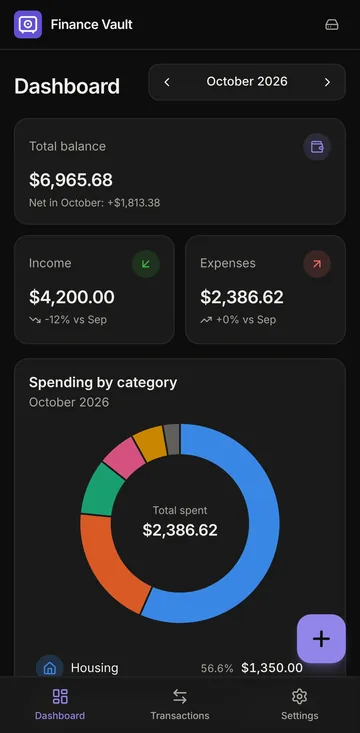
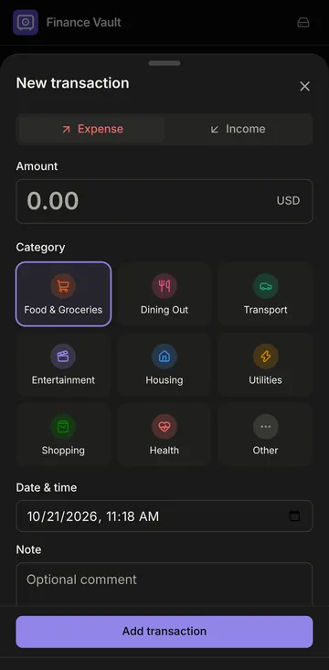
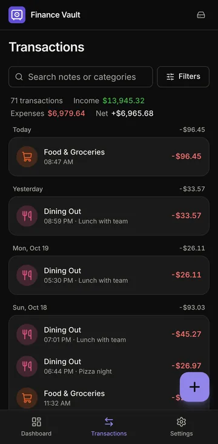
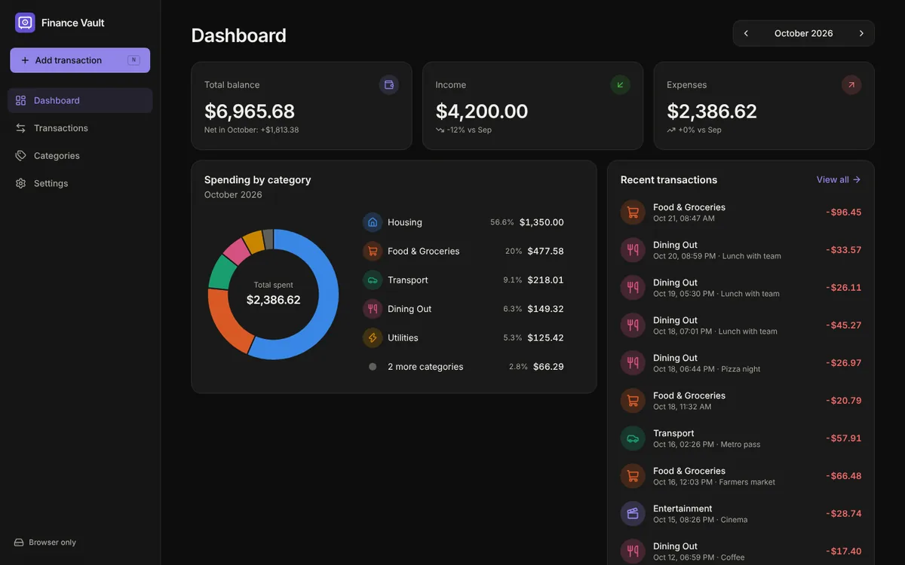
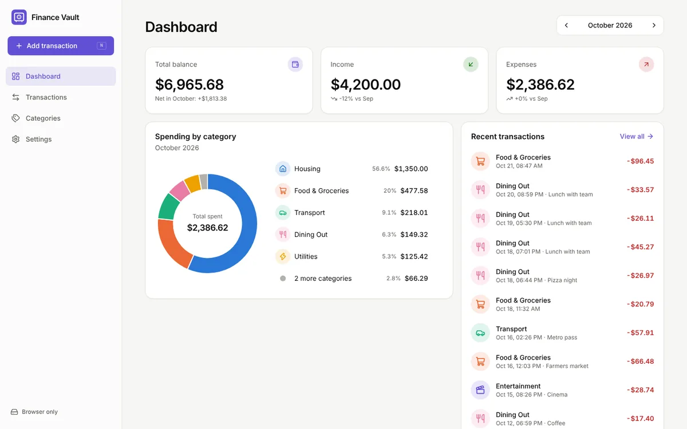
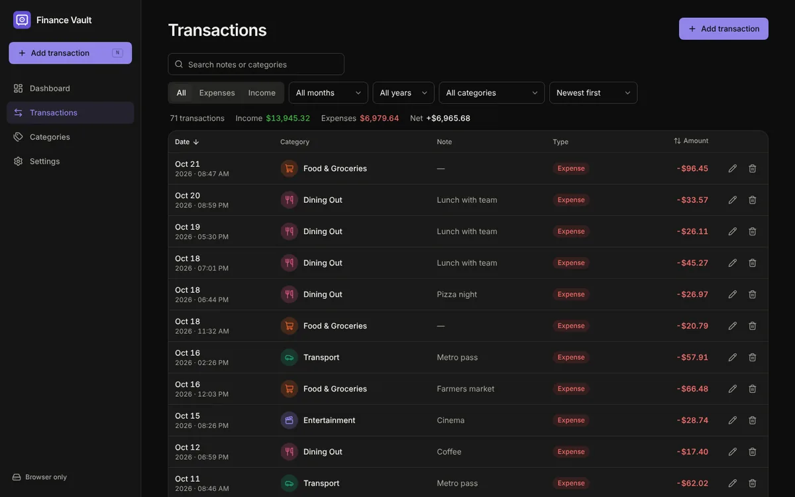
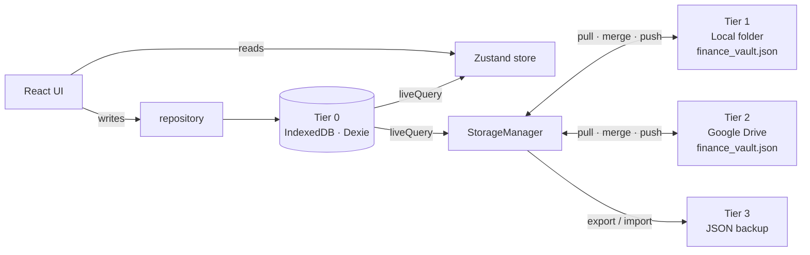

# Personal Finance Vault

An offline-first, installable personal finance tracker (PWA) with an **Obsidian-like vault**: your data lives
in your browser *and* in a single human-readable `finance_vault.json` file that you control: in a local folder
synced by iCloud Drive/Dropbox/Google Drive for desktop, in your Google Drive, or as a manual backup.
There is no server and no account.

<p>
  
  
  
</p>


<details>
<summary>More screenshots (light mode, transactions table)</summary>



</details>

## Features

- **Transactions**: add, edit, delete (with *Undo*). Each has an amount, type (expense/income), category, date and time,
  and note. Filter by month, year, type and category, search notes, and sort by date or amount. Filters live in the URL.
- **Categories**: custom name, type, HEX colour and Lucide icon; seeded with sensible defaults (Food & Groceries,
  Transport, Housing, Salary…). Deleting a category that is in use requires moving its transactions to another one.
- **Dashboard**: total balance, income and expenses for the selected month (with change vs. the previous month),
  an interactive doughnut of spending by category (hover/focus read-out, click to drill down) and the 12 most
  recent transactions with *View all*.
- **Mobile-first UI**: bottom navigation + floating action button opening a bottom sheet on phones; sidebar,
  grid cards and a sortable data table on tablets/desktops. Dark mode by default, light and system themes.
- **PWA**: installable on Android, iOS/iPadOS, Windows, macOS and Linux; works fully offline; prompts before updating.
  Keyboard shortcut <kbd>N</kbd> adds a transaction on desktop.

## Quick start

Requirements: Node.js 22.12+ and npm.

```bash
npm install
cp .env.example .env.local   # optional – only needed for real Google Drive sync
npm run dev                  # http://localhost:5173
```

| Script | What it does |
| --- | --- |
| `npm run dev` | Vite dev server with hot reload (service worker disabled) |
| `npm run build` | Type-check (`tsc -b`) and build the production PWA into `dist/` |
| `npm run preview` | Serve `dist/` on http://localhost:4173, including the service worker |
| `npm run typecheck` | TypeScript only |
| `npm run lint` | [oxlint](https://oxc.rs) |
| `npm test` | Unit tests (Vitest), covering merge, vault format, repository and the Drive adapter |
| `npm run generate-pwa-assets` | Regenerate the PNG/ICO icons in `public/` from `public/logo.svg` |

## Storage architecture



| Tier | Where | Best for | Code |
| --- | --- | --- | --- |
| **0 · Browser** | IndexedDB via Dexie. Always on; the app reads and writes here first, so it is instant and offline. | Every device | `src/db/` |
| **1 · Local folder** | File System Access API. You pick a directory once; the handle is remembered and `finance_vault.json` in it is kept in sync. Put the folder inside iCloud Drive, Dropbox, OneDrive or Google Drive for desktop and their apps carry it to your other devices. | Chrome/Edge on desktop, Chrome on Android | `src/sync/adapters/folderAdapter.ts` |
| **2 · Google Drive** | Google OAuth (Identity Services token model) + Drive v3 REST via `gapi`. Stores `My Drive/Personal Finance Vault/finance_vault.json`. | Safari on iPhone/iPad, any browser | `src/sync/google/` |
| **3 · Manual backup** | *Export to JSON* / *Import from JSON* (merge or replace). | Everything, as a fallback | `src/sync/storageManager.ts` |

Settings → **Storage** shows the current mode (*Browser Only*, *Local Folder*, *Google Drive* or both) and the
status of each tier.

### How syncing works

All writes go through `src/db/repository.ts`, which stamps every change with `updatedAt` and records deletions as
**tombstones**. `main.tsx` wires a Dexie `liveQuery` to both the UI store and the `StorageManager`, so *any*
committed change (from this tab, another tab or a sync) triggers syncing.

Each sync with a connected tier is **pull → merge → push**, run one at a time through a queue:

1. Read `finance_vault.json` (if it exists).
2. Merge it into IndexedDB in a single read-write transaction: per record, the newer `updatedAt` wins, and a
   tombstone deletes a record unless the record was edited after the deletion. Ties are broken deterministically, so
   every device converges to the same result (`src/sync/merge.ts`).
3. If the file differs from the merged data (compared by content fingerprint), write the merged result back.

Syncs are triggered by local changes (debounced 1.2 s), when the app regains focus or becomes visible, every
60 s while visible (a cheap revision check: file `lastModified` or Drive `version`), and when the device comes back
online. Changes made on another device therefore appear automatically.

Safety rules:

- A vault file that cannot be parsed is **never overwritten automatically**. The tier shows an error and an
  explicit *Overwrite file* action.
- Files written by a newer schema version are refused.
- Default categories have fixed ids, so two devices that start independently never create duplicates when they meet.
- An edit or delete is always stamped after the previous version of that record, even if another device's clock
  ran ahead.
- *Import → Replace everything* re-stamps the backup and tombstones everything else, so the restore also wins in
  connected vaults instead of being merged away.

### `finance_vault.json`

Pretty-printed and meant to be readable and hand-editable: categories grouped by type, newest transactions first.

```json
{
  "app": "personal-finance-vault",
  "schemaVersion": 1,
  "exportedAt": "2026-10-21T10:00:00.000Z",
  "data": {
    "categories": [
      {
        "id": "seed-food",
        "name": "Food & Groceries",
        "type": "expense",
        "color": "#eb6834",
        "icon": "ShoppingCart",
        "createdAt": "2024-01-01T00:00:00.000Z",
        "updatedAt": "2024-01-01T00:00:00.000Z"
      }
    ],
    "transactions": [
      {
        "id": "0b8f3c1e-…",
        "amount": 45.9,
        "type": "expense",
        "categoryId": "seed-food",
        "date": "2026-10-21T09:13:00.000Z",
        "note": "Weekly groceries",
        "createdAt": "2026-10-21T09:13:05.120Z",
        "updatedAt": "2026-10-21T09:13:05.120Z"
      }
    ],
    "tombstones": [{ "id": "…", "entity": "transaction", "deletedAt": "2026-10-20T18:00:00.000Z" }]
  }
}
```

- `amount` is always positive; the sign comes from `type`. Dates are ISO-8601 (UTC).
- `icon` is a key of `CATEGORY_ICONS` in `src/lib/icons.ts`; unknown names fall back to a tag icon.
- Hand edits are welcome: missing timestamps, numeric strings and negative amounts are accepted and normalized.
  Bump `updatedAt` (or remove it on new records) so your edit wins over older copies. The parser reports the exact
  path of anything invalid, e.g. `transactions[3].type must be "expense" or "income"`.
- TypeScript definitions: `src/types/finance.ts` and `src/types/vault.ts`.

## Google Drive setup

Without a client id the Drive card says *Not configured* and offers **Try simulated Drive**: a stand-in that
keeps the vault in `localStorage` so you can try the whole sync flow. It is not a backup.

To enable real Google Drive sync (free, about 5 minutes):

1. Open the [Google Cloud Console](https://console.cloud.google.com/) and create or select a project.
2. **APIs & Services → Library**: enable **Google Drive API**.
3. **APIs & Services → OAuth consent screen** (Google Auth Platform):
   - User type **External**; fill in the app name and support email.
   - **Data access / Scopes**: add `https://www.googleapis.com/auth/drive.file`. It is a non-sensitive scope:
     the app can only see files it created, nothing else in your Drive.
   - **Audience → Test users**: add the Google accounts you will use while the app is in *Testing*.
4. **APIs & Services → Credentials → Create credentials → OAuth client ID**:
   - Application type **Web application**.
   - **Authorized JavaScript origins**: `http://localhost:5173`, `http://localhost:4173` and your production
     origin, e.g. `https://finance.example.com` (scheme + host only, no path, no trailing slash).
   - Redirect URIs are not needed (popup token flow).
5. Put the client id into `.env.local` and restart Vite:

   ```bash
   VITE_GOOGLE_CLIENT_ID=1234567890-abc123.apps.googleusercontent.com
   ```

Notes:

- The client id is public by design (it ends up in the JavaScript bundle). No client secret or API key is used.
- Browser-only apps get short-lived access tokens (about 1 hour) and no refresh token. The token is kept in
  IndexedDB on that device so reloads do not ask again; when it expires, the card shows **Reconnect** (one tap,
  usually without re-entering anything). Local changes keep being saved and are uploaded after reconnecting.
- The sign-in popup is opened synchronously from the button click and Google's scripts are preloaded when Settings
  opens, which keeps Safari on iOS from blocking it.
- While your OAuth app is in *Testing*, Google limits it to the test users you listed. Publish it to lift that limit;
  because `drive.file` is a non-sensitive scope, publishing normally needs no security review.

## Browser support

| | Tier 0 Browser | Tier 1 Local folder | Tier 2 Google Drive | Tier 3 Backup |
| --- | :---: | :---: | :---: | :---: |
| Chrome / Edge / Opera (Windows, macOS, Linux, ChromeOS) | ✅ | ✅ | ✅ | ✅ |
| Chrome on Android | ✅ | ✅ when Chrome offers the folder picker (detected automatically) | ✅ | ✅ |
| Safari on iOS / iPadOS / macOS | ✅ | ❌ API not available | ✅ | ✅ |
| Firefox | ✅ | ❌ API not available | ✅ | ✅ |

Browsers usually forget folder permissions when they restart. The app then shows **Grant access** (one click).
Recent Chrome versions also offer *Allow on every visit*. Settings also offers **Keep data**, which asks the browser
to make storage persistent so IndexedDB is not evicted when the device runs low on space. Safari in particular may
clear data of websites you have not used for a while, so on iOS install the app to the Home Screen and connect
Google Drive.

## Deployment

Any static host works. HTTPS is required for the service worker, the File System Access API and Google sign-in
(`localhost` is exempt).

```bash
npm run build     # outputs dist/
```

- **Netlify / Vercel / Cloudflare Pages / Firebase Hosting**: publish `dist/`. No rewrite rules are needed: routing is
  hash-based (`/#/transactions`).
- **GitHub Pages (project site)**: build with the repository name as base path, then publish `dist/`:

  ```bash
  VITE_BASE_PATH=/<repository-name>/ npm run build
  ```

- Add the production origin to the OAuth client's *Authorized JavaScript origins*.

### Installing the app

- **Android / desktop Chrome & Edge**: use *Install app* in the sidebar or Settings, or the browser's install icon.
- **iPhone / iPad**: in Safari, tap **Share → Add to Home Screen**.

## Project structure

```
src/
├── main.tsx                 # bootstraps: Dexie liveQuery → UI store + StorageManager
├── App.tsx                  # hash router, lazy-loaded pages
├── types/                   # Transaction, Category, Tombstone, VaultFile, File System Access typings
├── db/
│   ├── database.ts          # Dexie schema (Tier 0) + first-run seeding
│   ├── seed.ts              # default categories (fixed ids)
│   └── repository.ts        # the only code that writes data; timestamps, tombstones, merge/replace
├── sync/
│   ├── storageManager.ts    # orchestrates all tiers, sync queue, triggers, import/export
│   ├── merge.ts             # pure last-writer-wins merge with tombstones
│   ├── vaultFormat.ts       # build / validate / fingerprint finance_vault.json
│   ├── adapters/            # VaultAdapter interface + File System Access adapter
│   └── google/              # GIS sign-in, Drive adapter (gapi), simulated Drive
├── store/                   # Zustand: finance data mirror, sync status, settings, UI
├── components/
│   ├── ui/                  # shadcn-style primitives (button, card, dialog/bottom sheet, …)
│   ├── layout/              # sidebar, bottom nav, FAB, sync indicator, update prompt
│   ├── dashboard/  transactions/  categories/  settings/
├── pages/                   # Dashboard, Transactions, Categories, Settings
└── lib/                     # money, dates, colours, Lucide icon map, utils
```

## Testing

`npm test` runs the unit tests:

- `sync/merge.test.ts`: last-writer-wins, tombstones, resurrection after a later edit, order independence, idempotency.
- `sync/vaultFormat.test.ts`: round-trip, lenient parsing of hand-edited files, precise validation errors.
- `db/repository.test.ts`: CRUD, tombstones, category reassignment, merge and replace against IndexedDB
  ([fake-indexeddb](https://github.com/dumbmatter/fakeIndexedDB)).
- `sync/google/googleDriveAdapter.test.ts`: the Drive adapter against an in-memory fake of the Drive API: folder and
  file creation, in-place updates, finding another device's vault, recovering from deleted or trashed files and folders,
  and expired sessions.
- `lib/money.test.ts`: amount parsing (`12,50`, `1.234,56`, `1,234.56`…) and float-safe sums.

## Design notes

- Category colours come from a categorical palette validated for colour-vision-deficiency separation in both themes.
  Default categories use it in order of typical spending, so neighbouring doughnut slices stay distinguishable.
  Preset colours switch to dedicated dark-mode steps. The doughnut shows at most 6 slices (the rest fold into
  "N more categories"), and its legend doubles as an accessible table with every value.
- Amounts always carry a +/− sign; colour only reinforces it. Text colours meet WCAG AA contrast in both themes.
- Money is rounded to cents and summed in integer cents to avoid floating-point drift.

## Known limitations

- Conflicts are resolved per record (newest edit wins), not per field. Editing the *same* transaction on two
  offline devices keeps only the later edit.
- Merging relies on reasonably correct device clocks (mitigated, see *Safety rules*).
- Each open tab syncs independently. This is safe (merges are idempotent) but redundant.
- Tombstones are kept indefinitely; they are tiny.
- Single display currency; amounts are not converted.

## Tech stack

React 19 · TypeScript · Vite 8 · vite-plugin-pwa (Workbox) · Tailwind CSS 4 with shadcn-style components ·
Lucide React · Recharts 3 · Zustand 5 · Dexie 4 · File System Access API · Google Identity Services + gapi
(Drive v3) · Vitest · oxlint
